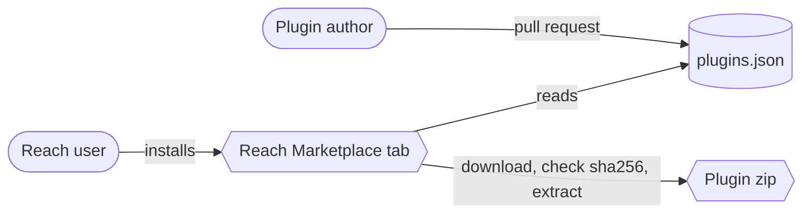

# reach-plugins-registry

A plugin registry for the [Reach](https://github.com/alexandrosnt/Reach) SSH client: one JSON file, `plugins.json`. Plugin authors can publish to it, and Reach users can point their Marketplace tab at it.

## Current state

`plugins.json` is `[]`. Reach does not read this repo by default; its built-in registry is the upstream author's `alexandrosnt/reach-plugins-registry`, which was also empty on 2026-10-10. Reach shows "No plugins available" for an empty array. Until an entry is added, this repo is a format reference and a template.

## How it works



Reach downloads the registry URL, parses a JSON array and lists each entry. On install it downloads `downloadUrl`, compares the SHA-256 to `sha256`, and only then extracts into `<plugins dir>/<id>/` through a staging folder. A missing or wrong hash fails the install. A higher `version` marks an installed plugin as updatable. The format comes from `marketplace.rs` and `schema.rs` in upstream Reach.

## Index format

| Field | Required | Meaning |
| --- | --- | --- |
| `id` | yes | Identifier and install folder. No `/`, `\`, `.` or null. |
| `name` | yes | Display name. |
| `version` | yes | Compared to the installed version for updates. |
| `downloadUrl` | yes | Direct URL of the release zip, HTTPS, at most 16 MiB. |
| `sha256` | yes | Hex SHA-256 of that zip. Empty blocks the install. |
| `description`, `author`, `repo`, `keywords` | no | Display and search fields. |
| `permissions` | no | Shown before install. |

Allowed permissions: `ssh_exec`, `ssh_list_connections`, `sftp_list`, `sftp_read`, `sftp_write`, `vault_read`, `vault_write`, `tunnel_manage`, `http`, `notify`, `ui`. One unknown value makes the whole index fail to parse and hides every plugin. The zip needs `plugin.toml` at its root; symlinks and paths that escape the folder are rejected.

## Add an entry

1. Publish the plugin as a zip with `plugin.toml` at the root.
2. Hash it: `sha256sum my-plugin.zip`.
3. Add an object to `plugins.json`, for example:

```json
{ "id": "my-plugin", "name": "My Plugin", "version": "1.0.0",
  "downloadUrl": "https://github.com/your-org/your-plugin/releases/download/v1.0.0/my-plugin.zip",
  "sha256": "<64 hex chars>", "permissions": ["notify"] }
```

4. Check it with `python3 scripts/validate.py`, then open a pull request. Merging admits the entry.

Example plugins: [reach-plugins](https://github.com/thefiredev-cloud/reach-plugins).

## Point Reach at this registry

In Reach, open Plugins > Marketplace > Registry, paste `https://raw.githubusercontent.com/thefiredev-cloud/reach-plugins-registry/main/plugins.json` and save. Default restores the built-in URL. The custom URL survives a restart only while the vault is unlocked.

## Status

No schema file, tests or CI. `scripts/validate.py` checks required fields, the id, the hash format and permissions.

## License

All rights reserved. See [LICENSE](LICENSE). Contact: [tanner@kodros.ai](mailto:tanner@kodros.ai).
