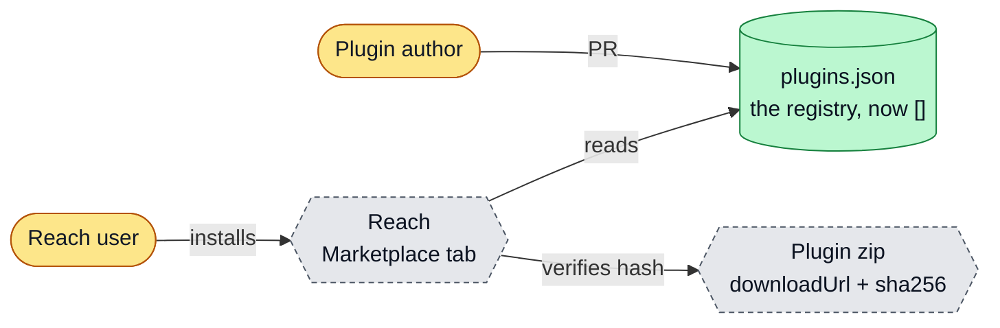
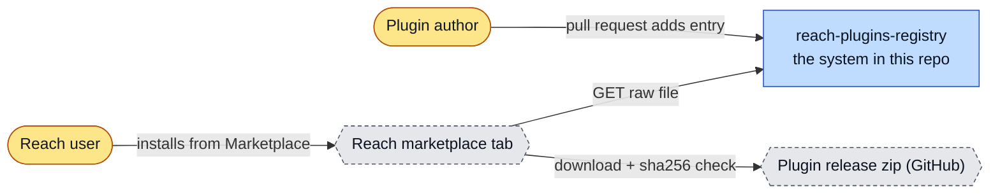
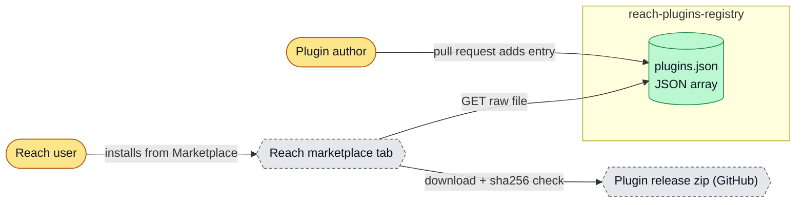
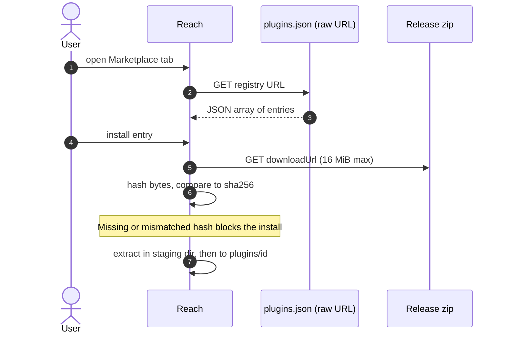
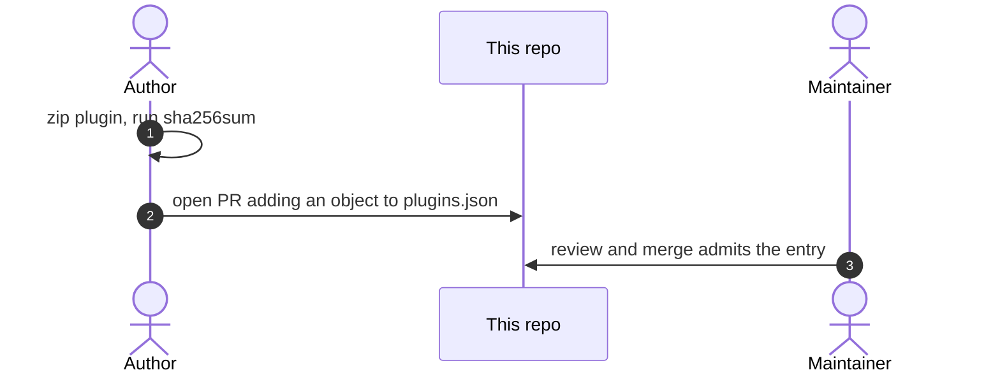
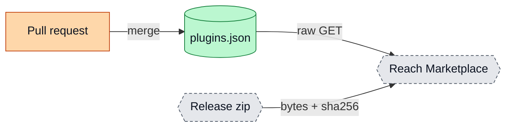
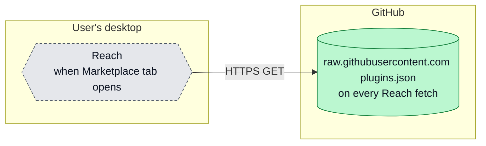

# reach-plugins-registry: architecture

<!-- arch-kit:generated -->

> Whiteboard-level structure: what systems exist, what they talk to, and when they run. Evidence-backed; every box below maps to a path listed in [Evidence](#10-evidence).
> Generated by the ArchDocs kit from repo commit `aafd6b5b40`. Diagram sources: [`architecture/*.mmd`](architecture/). Hi-res renders sit next to each source.

## 1. Purpose

reach-plugins-registry is a single JSON file, `plugins.json`, that can serve as a plugin registry for the Reach SSH client. Reach downloads the file, parses it as an array and lists each entry in its Marketplace tab; on install it downloads `downloadUrl`, checks the SHA-256 and extracts the zip. Today the array is empty (`[]`) and Reach does not read this repository by default, so the repo is a format reference and a template.

## 2. Whiteboard view

Five boxes. The repo is only the index; Reach and the plugin zips live elsewhere.

Hi-res: [SVG](architecture/whiteboard.svg) · [PNG 3x](architecture/whiteboard@3x.png) · [dark SVG](architecture/whiteboard.dark.svg) · [dark PNG 3x](architecture/whiteboard.dark@3x.png)

Explorable version (Archify, standalone HTML, download and open locally): [`architecture/reach-plugins-registry.archify.html`](architecture/reach-plugins-registry.archify.html)

## 3. System context (C4 level 1)

Who and what touches the system from outside.

Hi-res: [SVG](architecture/context.svg) · [PNG 3x](architecture/context@3x.png)

## 4. Containers and components (C4 level 2)

The parts that run or hold data inside the repo's system boundary.

Hi-res: [SVG](architecture/containers.svg) · [PNG 3x](architecture/containers@3x.png)

| Container | Kind | Tech | What it does | Evidence |
|---|---|---|---|---|
| plugins.json | store | JSON array | The registry index. Currently `[]`. | [`plugins.json`](../plugins.json), [`README.md#L9-L11`](../README.md#L9-L11) |

## 5. Key runtime sequences

### 5.1 Installing a plugin from the registry

Applies once an entry exists and a Reach install has its registry URL set to the raw file.

Hi-res: [SVG](architecture/sequence-1.svg) · [PNG 3x](architecture/sequence-1@3x.png)

### 5.2 Adding an entry

Hi-res: [SVG](architecture/sequence-2.svg) · [PNG 3x](architecture/sequence-2@3x.png)

## 6. Data flow and stores

One direction: entries are merged in, Reach reads them out.

Hi-res: [SVG](architecture/dataflow.svg) · [PNG 3x](architecture/dataflow@3x.png)

| Store | What it holds | Written by | Evidence |
|---|---|---|---|
| plugins.json | Array of {id, name, version, downloadUrl, sha256, permissions, ...}. Any unknown permission value fails the whole index. | Maintainer merges | [`plugins.json`](../plugins.json), [`README.md#L36-L51`](../README.md#L36-L51) |

## 7. Deployment and runtime topology

Served as a raw file from GitHub. No server, no CI, no schedule.

Hi-res: [SVG](architecture/deployment.svg) · [PNG 3x](architecture/deployment@3x.png)

| What | Where | Runs when | Trigger / port | Evidence |
|---|---|---|---|---|
| Registry fetch | Reach on the user's desktop | When the Marketplace tab loads | registry URL (default points at upstream author's repo) | [`README.md#L14`](../README.md#L14), [`README.md#L111`](../README.md#L111) |

## 8. Failure modes and how to see them

| Failure | What the user sees | How to see it | Evidence |
|---|---|---|---|
| One entry has an unknown permission value | Whole index fails to parse; every plugin disappears | Run the validation snippet in the README before commit | [`README.md#L51`](../README.md#L51), [`README.md#L89-L105`](../README.md#L89-L105) |
| sha256 missing or wrong | Install blocked | Reach install error | [`README.md#L48`](../README.md#L48) |
| Registry URL not set in Reach | Nothing reads this repo | Marketplace shows 'No plugins available' | [`README.md#L14`](../README.md#L14), [`README.md#L18`](../README.md#L18) |

## 9. State machine

No state machine in this repo: it is one static JSON file.

## 10. Evidence

Every path below exists at the pinned commit; links are relative to `docs/`.

| Path | Why it matters |
|---|---|
| [`plugins.json`](../plugins.json) | The registry index (currently an empty array). |
| [`README.md#L34-L55`](../README.md#L34-L55) | Index format and allowed permissions, taken from Reach's marketplace.rs and schema.rs. |
| [`README.md#L57-L62`](../README.md#L57-L62) | How to add an entry. |

Graphify (local AST, no LLM) read this repo: 9 nodes, 8 edges, 1 communities. Most connected: `reach-plugins-registry` (8), `Current state` (1), `How Reach uses a registry` (1), `Index format` (1), `Add an entry` (1).

- Report: [`architecture/graphify/GRAPH_REPORT.md`](architecture/graphify/GRAPH_REPORT.md)
- Interactive graph: [`architecture/graphify/graph.html`](architecture/graphify/graph.html) (26 KB, download and open locally)
